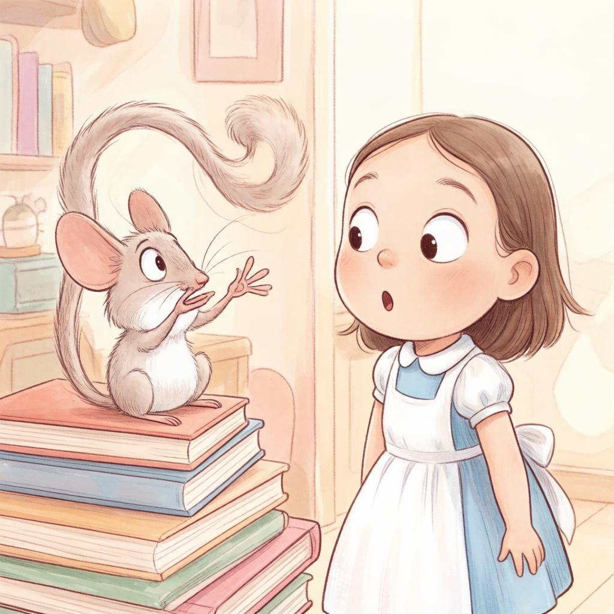

# Бенчмарк литературного анализа — задача №26

Реальный API-прогон: 2026-10-17T06:57:28.952190+00:00. Модель: **GigaChat-2-Max**; вызов через `GigaChatClient.analyze_text`, без изменений промпта и клиента в ходе бенчмарка.

**Валидная структура: 15/15. Полностью корректный текст по нашей рубрике: 5/15 (33.3%); частично: 8; неверный основной смысл: 2. Баллы текста: 64/90 (71.1%).** Это описательная оценка одного небольшого набора, не статистическая точность модели на всей литературе.

Медианное время метода: 2.766 с. Включает OAuth при первом запросе и возможные внутренние повторы клиента; число таких повторов отдельно не измерялось.

## Набор и методика

15 сложных отрывков из 5 реальных книг, 4 авторов. Только английский оригинал XIX века: другие языки и современная литература не охвачены. Набор специально сложный, не случайная репрезентативная выборка. Цитаты сверены с Project Gutenberg; chapter, абзацы и SHA-256 сохранены в cases.json. Полные книги находятся только в игнорируемом .cache. Их полные лицензии/заголовки не подменяются нашей разметкой.

Ожидаемые трактовки и корпус зафиксированы до API-запросов; они не передавались модели. Это новый набор относительно калибровочных синтетических примеров задачи №10, но оценка проведена тем же ассистентом, который подготовил задания. Нет независимых экспертов, слепой разметки и измерения согласия оценщиков.

Каждый результат оценён отдельно от валидности JSON. Баллы 0–2: перевод, привязка к контексту, дополнительный смысл/достоверность. Максимум 6 за текст; отдельная оценка image_prompt 0–2 в сумму текста не входит. correct означает 6/6; partial — основной смысл понят, но есть существенная потеря нюанса; incorrect — неверна центральная трактовка. Критерии и конкретные замечания записаны в reviews.json. Поле slang_or_etymology может быть null, если необходимый каламбур уже объяснён в context_meaning.

## Таблица 15 тестов

| № | Книга / место | Выделение | Тип сложности | Перевод | Контекст | Доп. смысл | Текст /6 | image /2 | Вердикт |
|---|---|---|---|---:|---:|---:|---:|---:|---|
| 1 | [Alice’s Adventures in Wonderland](https://www.gutenberg.org/ebooks/11) — Chapter III | long tail | wordplay | 2 | 2 | 2 | 6 | 2 | correct |
| 2 | [Alice’s Adventures in Wonderland](https://www.gutenberg.org/ebooks/11) — Chapter VII | murdering the time | wordplay_metaphor | 1 | 1 | 1 | 3 | 2 | partial |
| 3 | [Alice’s Adventures in Wonderland](https://www.gutenberg.org/ebooks/11) — Chapter IX | Take care of the sense, and the sounds will take care of themselves. | proverb_parody | 2 | 1 | 0 | 3 | 1 | partial |
| 4 | [Pride and Prejudice](https://www.gutenberg.org/ebooks/1342) — Chapter III | give consequence | historical_idiom | 2 | 2 | 2 | 6 | 1 | correct |
| 5 | [Pride and Prejudice](https://www.gutenberg.org/ebooks/1342) — Chapter VII | entailed | historical_term | 2 | 2 | 1 | 5 | 1 | partial |
| 6 | [Pride and Prejudice](https://www.gutenberg.org/ebooks/1342) — Chapter VIII | fine eyes | irony_subtext | 2 | 2 | 2 | 6 | 1 | correct |
| 7 | [A Christmas Carol](https://www.gutenberg.org/ebooks/46) — Stave I | dead as a door-nail | idiom | 1 | 2 | 2 | 5 | 0 | partial |
| 8 | [A Christmas Carol](https://www.gutenberg.org/ebooks/46) — Stave I | more of gravy than of grave | wordplay | 1 | 2 | 1 | 4 | 1 | partial |
| 9 | [A Christmas Carol](https://www.gutenberg.org/ebooks/46) — Stave I | Humbug | historical_colloquialism | 2 | 2 | 2 | 6 | 2 | correct |
| 10 | [Treasure Island](https://www.gutenberg.org/ebooks/120) — Chapter III | black spot | cultural_term | 2 | 1 | 1 | 4 | 2 | partial |
| 11 | [Treasure Island](https://www.gutenberg.org/ebooks/120) — Chapter IV | pieces of eight | historical_term | 2 | 2 | 1 | 5 | 0 | partial |
| 12 | [Treasure Island](https://www.gutenberg.org/ebooks/120) — Chapter XXVI | dead men don’t bite | violent_idiom | 2 | 1 | 1 | 4 | 1 | partial |
| 13 | [Great Expectations](https://www.gutenberg.org/ebooks/1400) — Chapter II | by hand | wordplay_historical | 0 | 1 | 0 | 1 | 1 | incorrect |
| 14 | [Great Expectations](https://www.gutenberg.org/ebooks/1400) — Chapter II | I Bolted | polysemy_colloquialism | 0 | 0 | 0 | 0 | 0 | incorrect |
| 15 | [Great Expectations](https://www.gutenberg.org/ebooks/1400) — Chapter VIII | common labouring-boy | class_subtext | 2 | 2 | 2 | 6 | 2 | correct |

## Что выявлено

Клиент надёжно отфильтровал формат в этом прогоне, но правильная Pydantic-модель не гарантирует верный смысл. Наиболее серьёзные ошибки — by hand (искусственное вскармливание/тяжёлая рука) и Bolted (заглатывание еды вместо побега). Пародия sense/sounds не распознана, каламбур gravy/grave раскрыт не полностью.

Во всех 15/15 ответах slang_or_etymology=null. Это валидно по схеме, но модель избегает отдельного культурного/этимологического объяснения даже там, где оно полезно. Изображения также требуют смысловой проверки: дверь с гвоздём вместо смысла идиомы, золотые монеты вместо серебряных, придуманная сцена с хватанием за волосы.

Рекомендуемый следующий шаг — отдельно доработать промпт для полисемии и игры слов, а затем повторить этот набор и новый независимый набор. В рамках №26 модельные ответы не исправлялись, промпт не подгонялся под оценку.

## 01_tale_tail

**Источник:** Lewis Carroll, *Alice’s Adventures in Wonderland*, Chapter III; [полный текст](https://www.gutenberg.org/cache/epub/11/pg11.txt).

**Выделение:** long tail

**Реальный контекст:**

> “Mine is a long and a sad tale!” said the Mouse, turning to Alice, and sighing.
> “It _is_ a long tail, certainly,” said Alice, looking down with wonder at the Mouse’s tail; “but why do you call it sad?” And she kept on puzzling about it while the Mouse was speaking, so that her idea of the tale was something like this:—

**Ожидаемый смысл (до запуска):** Алиса слышит tale (рассказ) как tail (хвост). Ответ должен сохранить буквальный хвост и объяснить омофонию, а не только длину истории.

**Ответ GigaChat:**

```json
{
  "translation": "длинный хвост",
  "context_meaning": "В данном контексте фраза «long tail» является игрой слов между словами 'tale' (история) и 'tail' (хвост), подчеркивая как длину рассказываемой истории Мышью, так и физическую особенность её длинного хвоста. Алиса воспринимает это буквально, удивляясь длине мышиных рассказов и одновременно рассматривая длинный хвост животного.",
  "slang_or_etymology": null,
  "image_prompt": "A mouse telling a story to Alice, emphasizing its long tail."
}
```

**Оценка:** Омофоны tale/tail и буквальное восприятие Алисы распознаны. Есть немного неточная фраза о длине рассказов, но центральная игра слов передана.

## 02_murdering_time

**Источник:** Lewis Carroll, *Alice’s Adventures in Wonderland*, Chapter VII; [полный текст](https://www.gutenberg.org/cache/epub/11/pg11.txt).

**Выделение:** murdering the time

**Реальный контекст:**

> “Well, I’d hardly finished the first verse,” said the Hatter, “when the Queen jumped up and bawled out, ‘He’s murdering the time! Off with his head!’”
> “How dreadfully savage!” exclaimed Alice.
> “And ever since that,” the Hatter went on in a mournful tone, “he won’t do a thing I ask! It’s always six o’clock now.”
> A bright idea came into Alice’s head. “Is that the reason so many tea-things are put out here?” she asked.
> “Yes, that’s it,” said the Hatter with a sigh: “it’s always tea-time, and we’ve no time to wash the things between whiles.”

**Ожидаемый смысл (до запуска):** Двойной смысл: плохое исполнение/нарушение музыкального времени и олицетворённое Время, обиженное Шляпником. Из-за этого часы стоят на шести. Не реальное убийство человека.

**Ответ GigaChat:**

```json
{
  "translation": "убивая время",
  "context_meaning": "В данном контексте фраза означает нарушение правильного течения времени, так как Шляпник исполняет песню неправильно, вызывая гнев Королевы. Это приводит к тому, что часы застывают на шести часах вечера, создавая вечную чайную церемонию.",
  "slang_or_etymology": null,
  "image_prompt": "The Mad Hatter singing off-key as the Queen angrily demands his execution."
}
```

**Оценка:** Связала неудачную песню, гнев Королевы и шесть часов, но «убивая время» звучит как безделье. Не раскрыты музыкальное время/ритм и олицетворённое Время, которое перестало слушаться Шляпника.

## 03_sense_sounds

**Источник:** Lewis Carroll, *Alice’s Adventures in Wonderland*, Chapter IX; [полный текст](https://www.gutenberg.org/cache/epub/11/pg11.txt).

**Выделение:** Take care of the sense, and the sounds will take care of themselves.

**Реальный контекст:**

> “Somebody said,” Alice whispered, “that it’s done by everybody minding their own business!”
> “Ah, well! It means much the same thing,” said the Duchess, digging her sharp little chin into Alice’s shoulder as she added, “and the moral of _that_ is—‘Take care of the sense, and the sounds will take care of themselves.’”
> “How fond she is of finding morals in things!” Alice thought to herself.

**Ожидаемый смысл (до запуска):** Пародия на Take care of the pence, and the pounds will take care of themselves; подмена pence/pounds на sense/sounds и навязчивый поиск морали Герцогиней. Не обычный совет о голосе.

**Ответ GigaChat:**

```json
{
  "translation": "Позаботься о смысле, и звуки сами позаботятся о себе.",
  "context_meaning": "Герцогиня даёт Алисе совет, который можно интерпретировать как рекомендацию сосредоточиться на содержании и сути дела, тогда форма и внешние проявления сложатся естественным образом. Это высказывание звучит как мораль истории, которую она рассказывает, подчеркивая важность осмысленности действий и слов.",
  "slang_or_etymology": null,
  "image_prompt": "A curious girl listening intently to a stern-looking older woman whispering advice."
}
```

**Оценка:** Перевод буквального предложения приемлем. Пропущена пародия на pence/pounds, реплика превращена в обычный полезный совет; упомянута несуществующая в отрывке рассказываемая Герцогиней история.

**Дополнительная проверка трактовки:** https://tile.loc.gov/storage-services/public/gdcmassbookdig/alicesadventures00carr_10/alicesadventures00carr_10.pdf

## 04_consequence

**Источник:** Jane Austen, *Pride and Prejudice*, Chapter III; [полный текст](https://www.gutenberg.org/cache/epub/1342/pg1342.txt).

**Выделение:** give consequence

**Реальный контекст:**

> “Which do you mean?” and turning round, he looked for a moment at Elizabeth, till, catching her eye, he withdrew his own, and coldly said, “She is tolerable: but not handsome enough to tempt _me_; and I am in no humour at present to give consequence to young ladies who are slighted by other men. You had better return to your partner and enjoy her smiles, for you are wasting your time with me.”
> Mr. Bingley followed his advice. Mr. Darcy walked off; and Elizabeth remained with no very cordial feelings towards him. She told the story, however, with great spirit among her friends; for she had a lively, playful disposition, which delighted in anything ridiculous.

**Ожидаемый смысл (до запуска):** Дарси не хочет оказывать вниманием общественную значимость девушкам, которыми пренебрегают другие. consequence здесь значимость/статус, не последствия или наказание.

**Ответ GigaChat:**

```json
{
  "translation": "придавать значение",
  "context_meaning": "Мистер Дарси говорит, что он не намерен обращать внимание на молодых девушек, которых игнорируют другие мужчины, подчеркивая своё высокомерие и нежелание считаться с чувствами окружающих. Его слова демонстрируют пренебрежительное отношение к Элизабет Беннет и подчёркивают его снобизм.",
  "slang_or_etymology": null,
  "image_prompt": "A man walking away from a group of people while another man looks disappointed."
}
```

**Оценка:** consequence понято как значение/внимание, а не последствия; снобизм Дарси и пренебрежение Элизабет объяснены. Визуальный prompt сильно упрощает сцену и придумывает разочарование Бингли.

## 05_entail

**Источник:** Jane Austen, *Pride and Prejudice*, Chapter VII; [полный текст](https://www.gutenberg.org/cache/epub/1342/pg1342.txt).

**Выделение:** entailed

**Реальный контекст:**

> Mr. Bennet’s property consisted almost entirely in an estate of two thousand a year, which, unfortunately for his daughters, was entailed, in default of heirs male, on a distant relation; and their mother’s fortune, though ample for her situation in life, could but ill supply the deficiency of his. Her father had been an attorney in Meryton, and had left her four thousand pounds.

**Ожидаемый смысл (до запуска):** Имущественное ограничение наследования: при отсутствии сыновей поместье переходит дальнему родственнику; дочери лишаются этого наследства. Не просто залог или необходимость.

**Ответ GigaChat:**

```json
{
  "translation": "был передан по наследству с ограничением права наследования женщинами",
  "context_meaning": "В романе Джейн Остин \"Гордость и предубеждение\" состояние мистера Беннета было ограничено законом майората, согласно которому поместье могло быть унаследовано только мужчиной. В случае отсутствия прямых мужских потомков оно переходило дальнему родственнику мужского пола, оставляя дочерей практически без наследства. Это создавало серьёзную финансовую проблему для семьи Беннет, так как их материальное положение зависело от небольшого состояния жены, которое не могло компенсировать потерю основного имущества.",
  "slang_or_etymology": null,
  "image_prompt": "A worried family discussing financial matters around a table."
}
```

**Оценка:** Мужская линия и последствия для дочерей верны. Но entail без оговорок назван законом майората: это слишком общее отождествление специального ограничения конкретного поместья с порядком наследования в целом.

**Дополнительная проверка трактовки:** https://www.jasna.org/publications-2/persuasions-online/volume-44-no-1/hall/

## 06_fine_eyes

**Источник:** Jane Austen, *Pride and Prejudice*, Chapter VIII; [полный текст](https://www.gutenberg.org/cache/epub/1342/pg1342.txt).

**Выделение:** fine eyes

**Реальный контекст:**

> “Certainly not.”
> “To walk three miles, or four miles, or five miles, or whatever it is, above her ancles in dirt, and alone, quite alone! what could she mean by it? It seems to me to show an abominable sort of conceited independence, a most country-town indifference to decorum.”
> “It shows an affection for her sister that is very pleasing,” said Bingley.
> “I am afraid, Mr. Darcy,” observed Miss Bingley, in a half whisper, “that this adventure has rather affected your admiration of her fine eyes.”
> “Not at all,” he replied: “they were brightened by the exercise.” A short pause followed this speech, and Mrs. Hurst began again,--

**Ожидаемый смысл (до запуска):** Каролина Бингли пытается высмеять привлекательность Элизабет после её прихода; Дарси возражает, что глаза стали ярче от движения. Красивые/выразительные глаза, не хорошее зрение; подкол и интерес Дарси.

**Ответ GigaChat:**

```json
{
  "translation": "красивыми глазами",
  "context_meaning": "В данном контексте фраза относится к героине Элизабет Беннет из романа Джейн Остин \"Гордость и предубеждение\", подчёркивая её физическую привлекательность, особенно глаза, которые привлекают внимание окружающих. Мисс Бингли намекает, что грязная прогулка может негативно сказаться на репутации девушки и уменьшить восхищение ею со стороны мистера Дарси. Однако мистер Дарси опровергает это предположение, утверждая, что физическая активность лишь подчеркнула красоту глаз Элизабет.",
  "slang_or_etymology": null,
  "image_prompt": "A woman with bright eyes walking through muddy terrain."
}
```

**Оценка:** Распознаны привлекательность Элизабет, выпад Каролины и ответ Дарси. Иллюстрация переносит акцент на предшествующую прогулку вместо разговора о ней.

## 07_door_nail

**Источник:** Charles Dickens, *A Christmas Carol*, Stave I; [полный текст](https://www.gutenberg.org/cache/epub/46/pg46.txt).

**Выделение:** dead as a door-nail

**Реальный контекст:**

> MARLEY was dead: to begin with. There is no doubt whatever about that. The register of his burial was signed by the clergyman, the clerk, the undertaker, and the chief mourner. Scrooge signed it: and Scrooge's name was good upon 'Change, for anything he chose to put his hand to. Old Marley was as dead as a door-nail.
> Mind! I don't mean to say that I know, of my own knowledge, what there is particularly dead about a door-nail. I might have been inclined, myself, to regard a coffin-nail as the deadest piece of ironmongery in the trade. But the wisdom of our ancestors is in the simile; and my unhallowed hands shall not disturb it, or the Country's done for. You will therefore permit me to repeat, emphatically, that Marley was as dead as a door-nail.

**Ожидаемый смысл (до запуска):** Совершенно мёртв: повествователь настаивает на смерти Марли, чтобы последующее появление призрака было значимым; шутит о буквальном гвозде. Не описание самого гвоздя как умершего.

**Ответ GigaChat:**

```json
{
  "translation": "мёртв как дверной гвоздь",
  "context_meaning": "Автор подчёркивает абсолютную несомненность смерти Марли, используя устойчивое сравнение, которое подчеркивает окончательность произошедшего. Он также шутливо замечает, что сам не знает, почему именно дверной гвоздь стал символом чего-то окончательно мёртвого, но уважает традицию этого сравнения. Таким образом, фраза усиливает уверенность читателя в том, что смерть персонажа бесспорна и необратима.",
  "slang_or_etymology": null,
  "image_prompt": "An old-fashioned door with an ornate nail prominently displayed."
}
```

**Оценка:** Контекстная окончательность смерти и авторская шутка объяснены. Перевод — калька вместо естественного «совершенно мёртв». Картинка показывает дверь с гвоздём, а не литературную сцену с Марли/рассказчиком.

## 08_gravy_grave

**Источник:** Charles Dickens, *A Christmas Carol*, Stave I; [полный текст](https://www.gutenberg.org/cache/epub/46/pg46.txt).

**Выделение:** more of gravy than of grave

**Реальный контекст:**

> "Because," said Scrooge, "a little thing affects them. A slight disorder of the stomach makes them cheats. You may be an undigested bit of beef, a blot of mustard, a crumb of cheese, a fragment of an underdone potato. There's more of gravy than of grave about you, whatever you are!"
> Scrooge was not much in the habit of cracking jokes, nor did he feel, in his heart, by any means waggish then. The truth is, that he tried to be smart, as a means of distracting his own attention, and keeping down his terror; for the spectre's voice disturbed the very marrow in his bones.

**Ожидаемый смысл (до запуска):** Созвучие gravy (подливка) и grave (могила): Скрудж объясняет призрака несварением и шутит, подавляя страх. Не призрак, буквально состоящий из соуса.

**Ответ GigaChat:**

```json
{
  "translation": "больше соуса, чем могилы",
  "context_meaning": "Скрудж пытается отвлечь себя от страха перед призраком, утверждая, что тот может быть всего лишь результатом несварения желудка. Он говорит это скорее для самоуспокоения, так как голос привидения пугает его до глубины души. Фраза подчеркивает абсурдность и комичность попытки объяснить сверхъестественное явление обыденными причинами вроде еды.",
  "slang_or_etymology": null,
  "image_prompt": "Man arguing with ghostly figure while holding hand to chest."
}
```

**Оценка:** Несварение, отрицание призрака и подавление страха поняты. Однако созвучие gravy/grave явно не объяснено, перевод буквальный и сам по себе не восстанавливает каламбур. Жест руки на груди придуман.

## 09_humbug

**Источник:** Charles Dickens, *A Christmas Carol*, Stave I; [полный текст](https://www.gutenberg.org/cache/epub/46/pg46.txt).

**Выделение:** Humbug

**Реальный контекст:**

> "A merry Christmas, uncle! God save you!" cried a cheerful voice. It was the voice of Scrooge's nephew, who came upon him so quickly that this was the first intimation he had of his approach.
> "Bah!" said Scrooge, "Humbug!"
> He had so heated himself with rapid walking in the fog and frost, this nephew of Scrooge's, that he was all in a glow; his face was ruddy and handsome; his eyes sparkled, and his breath smoked again.
> "Christmas a humbug, uncle!" said Scrooge's nephew. "You don't mean that, I am sure?"
> "I do," said Scrooge. "Merry Christmas! What right have you to be merry? What reason have you to be merry? You're poor enough."

**Ожидаемый смысл (до запуска):** Скрудж презрительно называет рождественские поздравления чепухой/обманом/вздором; это скептическое отвержение праздника, не жук, не имя человека.

**Ответ GigaChat:**

```json
{
  "translation": "Чепуха",
  "context_meaning": "Скрудж выражает своё пренебрежительное отношение к празднику Рождества, считая его бессмысленным и лицемерным мероприятием. Он резко реагирует на приветствие племянника, который искренне радуется наступлению праздника, подчеркивая тем самым разницу во взглядах между ними. Скрудж подчёркивает свою позицию, утверждая, что бедность племянника делает неуместными любые проявления радости и веселья.",
  "slang_or_etymology": null,
  "image_prompt": "A cold and bitter man scowls at his cheerful nephew during Christmas."
}
```

**Оценка:** Чепуха и презрительное отвержение рождественского поздравления поняты; контраст дяди и племянника соответствует абзацу.

## 10_black_spot

**Источник:** Robert Louis Stevenson, *Treasure Island*, Chapter III; [полный текст](https://www.gutenberg.org/cache/epub/120/pg120.txt).

**Выделение:** black spot

**Реальный контекст:**

> I went down on my knees at once. On the floor close to his hand there was a little round of paper, blackened on the one side. I could not doubt that this was the _black spot;_ and taking it up, I found written on the other side, in a very good, clear hand, this short message: “You have till ten tonight.”

**Ожидаемый смысл (до запуска):** Пиратская чёрная метка: почерневший кружок бумаги с ультиматумом до десяти; знак угрозы/приговора. Не болезнь или просто грязное пятно. Не выдавать литературный обычай за доказанную общую историю пиратов.

**Ответ GigaChat:**

```json
{
  "translation": "чёрная метка",
  "context_meaning": "В романе «Остров сокровищ» чёрная метка символизирует угрозу со стороны пиратов. Получив её, человек должен ожидать нападения или расправы до указанного времени. В данном эпизоде главный герой находит такую метку рядом с рукой другого персонажа, подтверждая серьёзность опасности.",
  "slang_or_etymology": null,
  "image_prompt": "A man kneeling on the floor next to an outstretched hand, holding a small piece of blackened paper with writing on it."
}
```

**Оценка:** Чёрная метка и пиратская угроза распознаны. Но дедлайн «до десяти» неверно превращён в обещание нападения/расправы до этого времени; в абзаце это срок ультиматума.

## 11_pieces_eight

**Источник:** Robert Louis Stevenson, *Treasure Island*, Chapter IV; [полный текст](https://www.gutenberg.org/cache/epub/120/pg120.txt).

**Выделение:** pieces of eight

**Реальный контекст:**

> It was a long, difficult business, for the coins were of all countries and sizes--doubloons, and louis d’ors, and guineas, and pieces of eight, and I know not what besides, all shaken together at random. The guineas, too, were about the scarcest, and it was with these only that my mother knew how to make her count.

**Ожидаемый смысл (до запуска):** Испанские серебряные монеты достоинством восемь реалов среди разных валют в сундуке; не восемь случайных кусочков и не обязательно золотые монеты.

**Ответ GigaChat:**

```json
{
  "translation": "пиастры",
  "context_meaning": "В данном контексте речь идет о разнообразии монет из сокровищ пиратов, среди которых упоминаются различные валюты разных стран, включая испанские монеты 'pieces of eight', известные как пиастры. Эти монеты были распространены в эпоху колониальных завоеваний и часто фигурируют в приключенческих романах о пиратах. Мать рассказчика пытается разобраться в этой мешанине валют, чтобы подсчитать стоимость найденных денег, но ей знакомее всего английские гинеи, которые оказываются самыми редкими в куче монет.",
  "slang_or_etymology": null,
  "image_prompt": "A woman sorting through a pile of mixed gold coins from different countries."
}
```

**Оценка:** Пиастры и смешанные валюты поняты, но не раскрыто eight=восемь реалов. В image_prompt все монеты названы золотыми, хотя piece of eight — серебряная монета.

## 12_dead_men

**Источник:** Robert Louis Stevenson, *Treasure Island*, Chapter XXVI; [полный текст](https://www.gutenberg.org/cache/epub/120/pg120.txt).

**Выделение:** dead men don’t bite

**Реальный контекст:**

> “For thirty years,” he said, “I’ve sailed the seas and seen good and bad, better and worse, fair weather and foul, provisions running out, knives going, and what not. Well, now I tell you, I never seen good come o’ goodness yet. Him as strikes first is my fancy; dead men don’t bite; them’s my views--amen, so be it. And now, you look here,” he added, suddenly changing his tone, “we’ve had about enough of this foolery. The tide’s made good enough by now. You just take my orders, Cap’n Hawkins, and we’ll sail slap in and be done with it.”

**Ожидаемый смысл (до запуска):** Мёртвые не могут отомстить/помешать: Хэндс оправдывает упреждающее насилие, предпочитает ударить первым; не совет о животных или просто очевидный биологический факт.

**Ответ GigaChat:**

```json
{
  "translation": "Мёртвые не кусаются",
  "context_meaning": "Персонаж выражает циничную позицию, согласно которой лучше действовать решительно и первым нанести удар, так как мёртвый противник уже не сможет причинить вреда. Это подчёркивает его опытность и практичность, накопленные за годы морских приключений. В данном контексте фраза служит аргументом в пользу решительных действий капитана Хокинса, чтобы завершить опасное предприятие и избежать дальнейших рисков.",
  "slang_or_etymology": null,
  "image_prompt": "A grizzled old seaman sternly advises a young captain on a ship's deck."
}
```

**Оценка:** Идея ударить первым, чтобы противник не причинил вреда, верна. Но речь Хэндса подана как полезный совет капитану, сглажены угроза и циничное оправдание насилия; в исходной сцене Хэндс опасен Джиму.

## 13_by_hand

**Источник:** Charles Dickens, *Great Expectations*, Chapter II; [полный текст](https://www.gutenberg.org/cache/epub/1400/pg1400.txt).

**Выделение:** by hand

**Реальный контекст:**

> My sister, Mrs. Joe Gargery, was more than twenty years older than I, and had established a great reputation with herself and the neighbours because she had brought me up “by hand.” Having at that time to find out for myself what the expression meant, and knowing her to have a hard and heavy hand, and to be much in the habit of laying it upon her husband as well as upon me, I supposed that Joe Gargery and I were both brought up by hand.

**Ожидаемый смысл (до запуска):** Базовое старое значение — вскармливание младенца без матери/кормилицы; детский Пип связывает выражение с тяжёлой рукой сестры и побоями. Нужны оба слоя, не только строгая дисциплина.

**Ответ GigaChat:**

```json
{
  "translation": "своими силами, собственными руками",
  "context_meaning": "В данном контексте фраза означает самостоятельное воспитание ребёнка без посторонней помощи, подчёркивая строгость и суровость методов воспитания старшей сестры рассказчика. Она гордится тем, что воспитала брата сама, часто прибегая к физическим наказаниям как по отношению к нему, так и к своему мужу Джо Гарджери.",
  "slang_or_etymology": null,
  "image_prompt": "A stern-looking woman standing over a young boy, holding him firmly."
}
```

**Оценка:** Воспитание своими силами не передаёт старое значение искусственного вскармливания. Суровость и побои замечены, но исторический слой и детское переосмысление выражения потеряны.

**Дополнительная проверка трактовки:** https://www.ncgsjournal.com/issue41/antonio.html, https://academic.oup.com/cornell-scholarship-online/book/56639/chapter-abstract/453306062

## 14_bolted

**Источник:** Charles Dickens, *Great Expectations*, Chapter II; [полный текст](https://www.gutenberg.org/cache/epub/1400/pg1400.txt).

**Выделение:** I Bolted

**Реальный контекст:**

> “You know, Pip,” said Joe, solemnly, with his last bite in his cheek, and speaking in a confidential voice, as if we two were quite alone, “you and me is always friends, and I’d be the last to tell upon you, any time. But such a—” he moved his chair and looked about the floor between us, and then again at me—“such a most oncommon Bolt as that!”
> “Been bolting his food, has he?” cried my sister.
> “You know, old chap,” said Joe, looking at me, and not at Mrs. Joe, with his bite still in his cheek, “I Bolted, myself, when I was your age—frequent—and as a boy I’ve been among a many Bolters; but I never see your Bolting equal yet, Pip, and it’s a mercy you ain’t Bolted dead.”
> My sister made a dive at me, and fished me up by the hair, saying nothing more than the awful words, “You come along and be dosed.”

**Ожидаемый смысл (до запуска):** Джо говорит о быстром заглатывании пищи, не о побеге или запирании двери; сравнивает Пипа с собой ребёнком, боится, что тот подавится. Контекст еды и кусок за щекой важны.

**Ответ GigaChat:**

```json
{
  "translation": "Я убегал",
  "context_meaning": "Джо вспоминает своё детство и говорит Пипу, что сам часто сбегал из дома, когда был мальчиком. Он подчёркивает, что никогда раньше не видел такого быстрого бегства, как у Пипа, и считает чудом, что тот остался живым после своих побегов.",
  "slang_or_etymology": null,
  "image_prompt": "A woman grabs a young boy's hair while an older man looks on."
}
```

**Оценка:** Ключевая ошибка многозначности: bolted означает быстро заглатывал пищу, не убегал. В тексте есть еда и кусок за щекой; модель придумала побеги и визуальную сцену с хватанием за волосы.

## 15_common_boy

**Источник:** Charles Dickens, *Great Expectations*, Chapter VIII; [полный текст](https://www.gutenberg.org/cache/epub/1400/pg1400.txt).

**Выделение:** common labouring-boy

**Реальный контекст:**

> Miss Havisham beckoned her to come close, and took up a jewel from the table, and tried its effect upon her fair young bosom and against her pretty brown hair. “Your own, one day, my dear, and you will use it well. Let me see you play cards with this boy.”
> “With this boy? Why, he is a common labouring-boy!”
> I thought I overheard Miss Havisham answer,—only it seemed so unlikely,—“Well? You can break his heart.”
> “What do you play, boy?” asked Estella of myself, with the greatest disdain.

**Ожидаемый смысл (до запуска):** Эстелла презрительно называет Пипа простым мальчиком из рабочего сословия; common — низкое социальное положение в её оценке, а не общий/обычный трудящийся без подтекста. Контраст богатого дома и презрения к происхождению.

**Ответ GigaChat:**

```json
{
  "translation": "обычный мальчик из простонародья, занимающийся физическим трудом",
  "context_meaning": "Эстелла презрительно реагирует на указание мисс Хэвишем поиграть в карты с Пипом, подчеркивая его низкое социальное положение и физическую работу как признак низкого статуса. Это подчёркивает классовые различия между персонажами и отношение Эстеллы к людям ниже её социального уровня.",
  "slang_or_etymology": null,
  "image_prompt": "A wealthy girl looks down on a working-class boy while an older woman watches them."
}
```

**Оценка:** Верно переданы рабочее происхождение Пипа, классовое презрение Эстеллы и контекст предложения поиграть в карты.

## PoC генерации иллюстрации

Скрипт generate_scene.py берёт image_prompt из фактического результата бенчмарка и отправляет отдельный запрос GigaChat с function_call=auto. Затем извлекает UUID из тега img и скачивает JPG через GET /files/{file_id}/content. Это встроенный text2image GigaChat, а не локальная заглушка и не другая модель, выданная за Kandinsky.

Параметры и фактический ответ: [illustration/request-and-result.json](illustration/request-and-result.json). Иллюстрация: [illustration/scene.jpg](illustration/scene.jpg). Seed, шаги диффузии и размер запроса через этот PoC не задаются; их значения нельзя выдумывать.



Визуально проверено: персонажи узнаваемы, но добавлены интерьер и стопка книг, которых нет в цитате; пушистый хвост похож на беличий. Это работоспособный PoC цепочки, не гарантия точной иллюстрации оригинальной главы.

Документация: https://developers.sber.ru/docs/ru/gigachat/guides/images-generation
