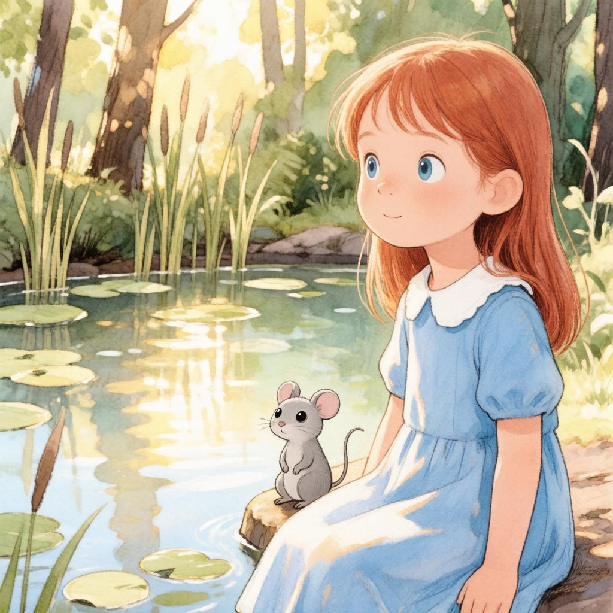
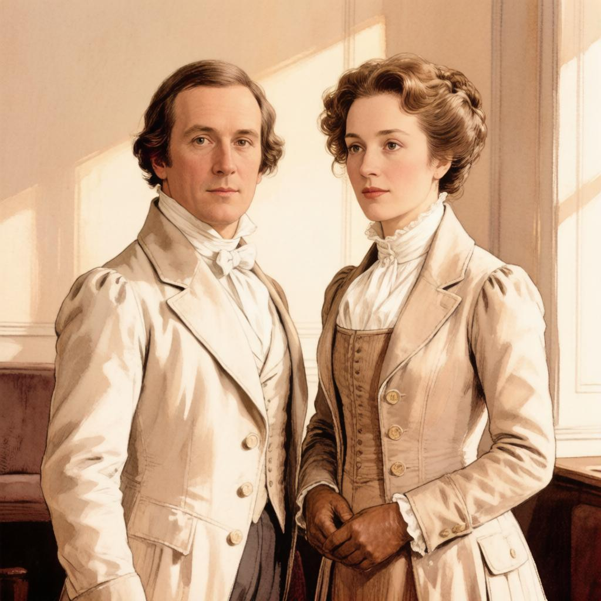
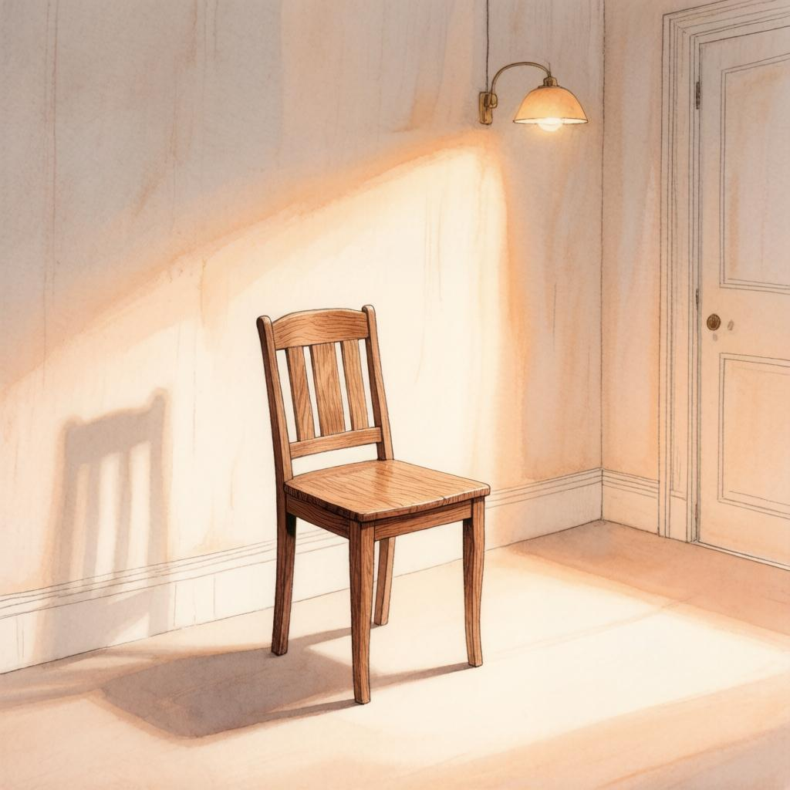
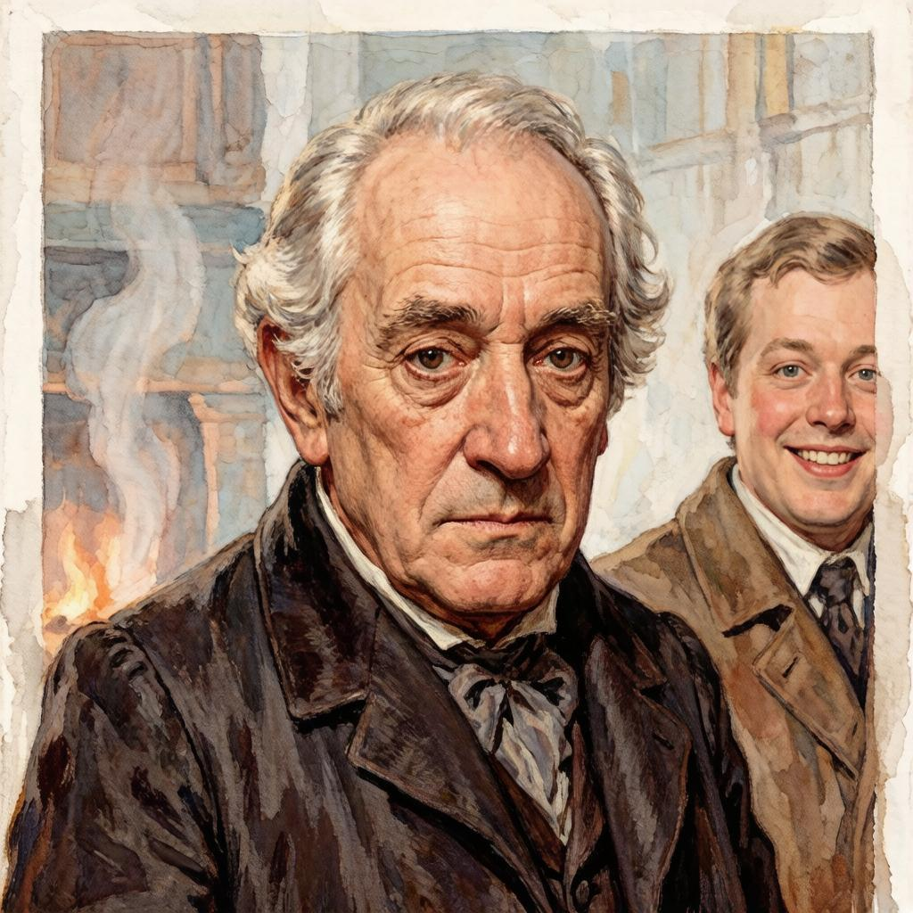
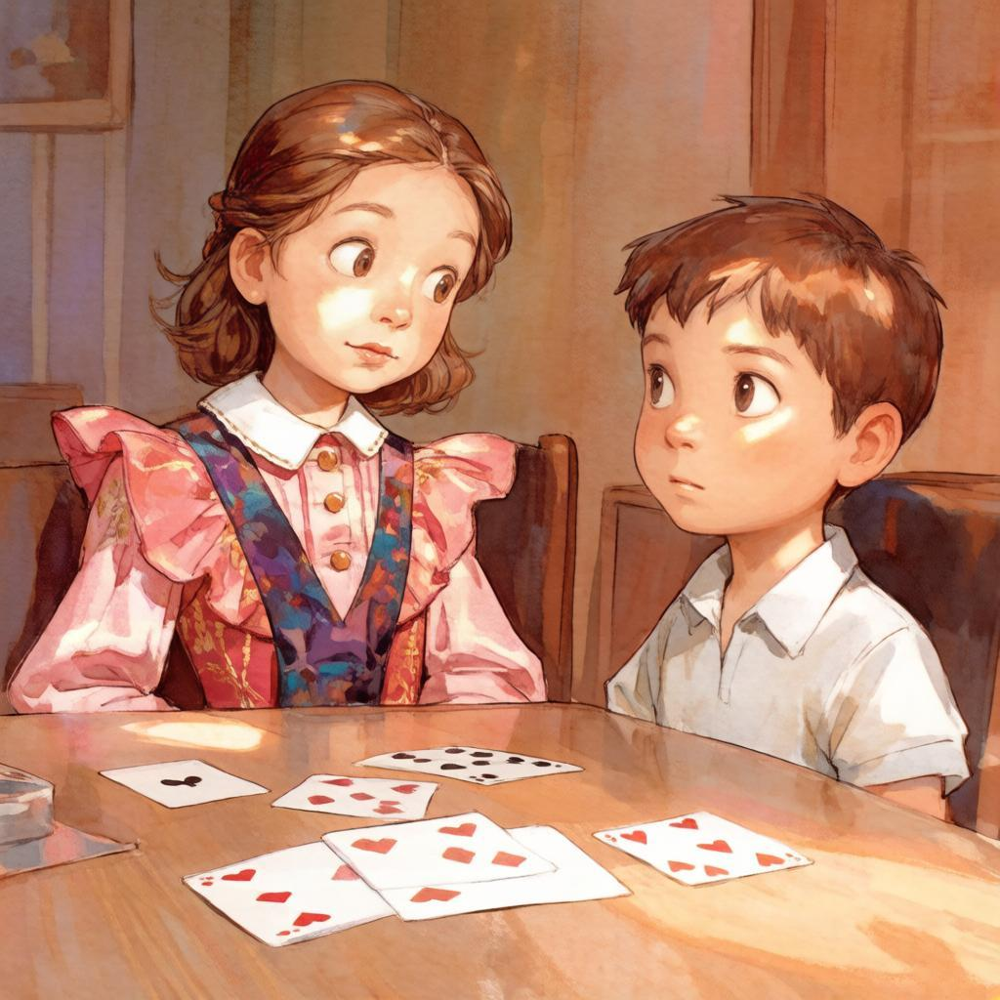

# Пять книжных иллюстраций — задача №40

Все пять финальных изображений реально получены через GigaChat text2image. Они подготовлены офлайн с отдельным ожиданием до 90 секунд. Рабочий ImageGenerationClient по-прежнему ограничен 15 секундами и при задержке возвращает заглушку.

[Интерактивные попытки с таймаутами](interactive-timeout-log.json) · [Финальные параметры/время](generation-log.json) · [Исходники и калибровка](scenes.json) · [Первые реальные варианты](calibration-before/generation-log.json)

## Сводка

| Книга | Исходная идиома | Файл | Время офлайн, с |
|---|---|---|---:|
| Alice’s Adventures in Wonderland | long tail | [01_tale_tail.jpg](01_tale_tail.jpg) | 21.125 |
| Pride and Prejudice | fine eyes | [06_fine_eyes.jpg](06_fine_eyes.jpg) | 21.141 |
| A Christmas Carol | dead as a door-nail | [07_door_nail.jpg](07_door_nail.jpg) | 21.094 |
| A Christmas Carol | Humbug | [09_humbug.jpg](09_humbug.jpg) | 25.656 |
| Great Expectations | common labouring-boy | [15_common_boy.jpg](15_common_boy.jpg) | 19.594 |

## Что калибровалось

Сохранены три уровня: исходная идиома/контекст, прежний image_prompt из бенчмарка и вручную уточнённая сцена. Добавлены единый живописный книжный стиль и запрет текста. В первом прогоне замечены потеря Алисы, псевдозаписи в конторской книге, слишком приветливый Скрудж и взрослые персонажи вместо детей. Для повторной генерации явно заданы персонажи, пустые поверхности и закрытые/перевёрнутые карты.

Изменения не маскируют запрещённое содержание: показаны безопасные литературные ассоциации без натуралистических деталей. Отказы провайдера не обходятся. Стилизация не гарантирует точную историческую реконструкцию или отсутствие любых мелких артефактов.

## long tail — Alice’s Adventures in Wonderland

[Оригинал, Chapter III](https://www.gutenberg.org/ebooks/11)

**Прежний prompt бенчмарка:** A mouse telling a story to Alice, emphasizing its long tail.

**Откалиброванная сцена:** A human child in a blue pinafore sits beside a tiny grey mouse at a natural woodland pond.

**Фактический запрос со стилем:** A human child in a blue pinafore sits beside a tiny grey mouse at a natural woodland pond, book illustration style, painterly watercolor and ink, cinematic lighting, no text, no letters, no numbers, no writing, no watermark

**Визуальная проверка ассистентом:** В финале видны девочка и Мышь у естественного пруда, книжный акварельный стиль. Читаемых букв/надписей не обнаружено. Детали костюма — художественная адаптация.

## fine eyes — Pride and Prejudice

[Оригинал, Chapter VIII](https://www.gutenberg.org/ebooks/1342)

**Прежний prompt бенчмарка:** A woman with bright eyes walking through muddy terrain.

**Откалиброванная сцена:** Two adults in Regency clothing face one another in a softly lit drawing room with blank walls.

**Фактический запрос со стилем:** Two adults in Regency clothing face one another in a softly lit drawing room with blank walls, book illustration style, painterly watercolor and ink, cinematic lighting, no text, no letters, no numbers, no writing, no watermark

**Визуальная проверка ассистентом:** Двое взрослых в стилизованном историческом интерьере; нет видимых надписей. Композиция более портретная, чем разговорная, одежду нельзя считать точной реконструкцией эпохи Регентства.

## dead as a door-nail — A Christmas Carol

[Оригинал, Stave I](https://www.gutenberg.org/ebooks/46)

**Прежний prompt бенчмарка:** An old-fashioned door with an ornate nail prominently displayed.

**Откалиброванная сцена:** An unoccupied wooden chair in a dim Victorian room with empty walls, warm lamplight and a closed door.

**Фактический запрос со стилем:** An unoccupied wooden chair in a dim Victorian room with empty walls, warm lamplight and a closed door, book illustration style, painterly watercolor and ink, cinematic lighting, no text, no letters, no numbers, no writing, no watermark

**Визуальная проверка ассистентом:** Пустой стул, лампа и закрытая дверь передают ассоциацию отсутствия. После удаления бумажного реквизита нет псевдозаписей и букв. Это визуальная адаптация контекста смерти Марли, не буквальный гвоздь и не иллюстрация исторического факта.

## Humbug — A Christmas Carol

[Оригинал, Stave I](https://www.gutenberg.org/ebooks/46)

**Прежний prompt бенчмарка:** A cold and bitter man scowls at his cheerful nephew during Christmas.

**Откалиброванная сцена:** Ebenezer Scrooge, an elderly miser in a dark Victorian coat, scowls at his smiling adult nephew Fred.

**Фактический запрос со стилем:** Ebenezer Scrooge, an elderly miser in a dark Victorian coat, scowls at his smiling adult nephew Fred, book illustration style, painterly watercolor and ink, cinematic lighting, no text, no letters, no numbers, no writing, no watermark

**Визуальная проверка ассистентом:** Угрюмый пожилой Скрудж контрастирует с улыбающимся взрослым племянником. Читаемых букв нет. Костюмы и фон остаются стилизацией, а не достоверной исторической реконструкцией.

## common labouring-boy — Great Expectations

[Оригинал, Chapter VIII](https://www.gutenberg.org/ebooks/1400)

**Прежний prompt бенчмарка:** A wealthy girl looks down on a working-class boy while an older woman watches them.

**Откалиброванная сцена:** Two children, a richly dressed girl and a plainly dressed boy, at a table with plain face-down cards.

**Фактический запрос со стилем:** Two children, a richly dressed girl and a plainly dressed boy, at a table with plain face-down cards, book illustration style, painterly watercolor and ink, cinematic lighting, no text, no letters, no numbers, no writing, no watermark

**Визуальная проверка ассистентом:** Показаны двое детей, заметен контраст одежды, иллюстративный стиль. На картах видны масти, но нет букв/печатных цифр. Генератор всё же показал карты лицом вверх вопреки промпту; это оставшееся нарушение следования описанию.
